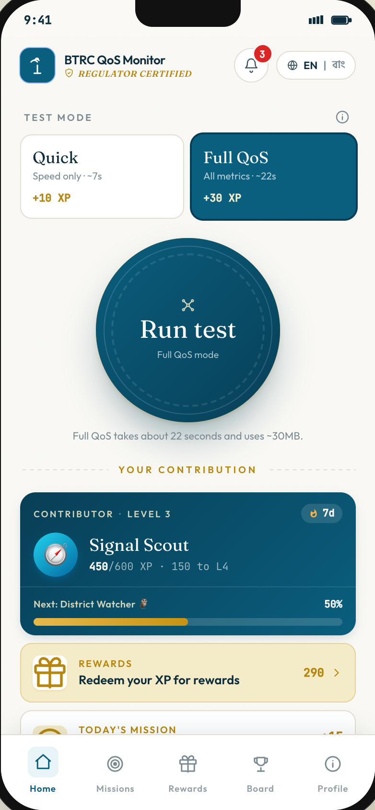
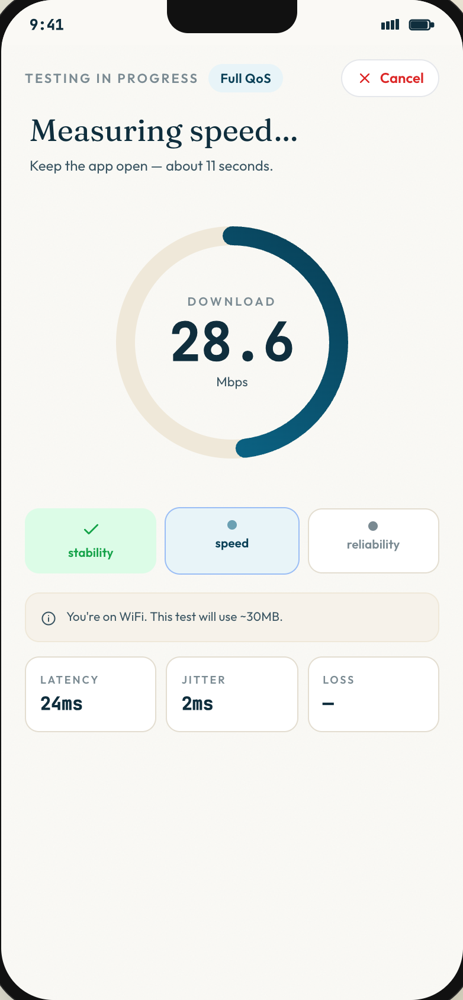
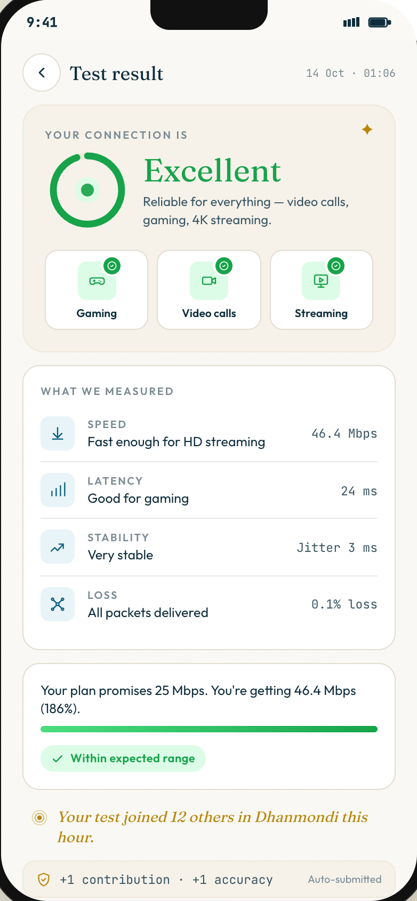
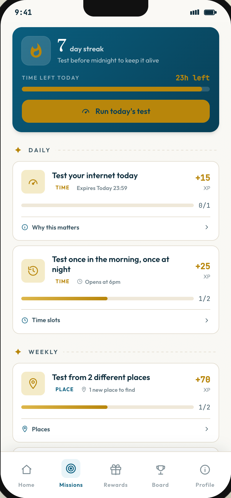
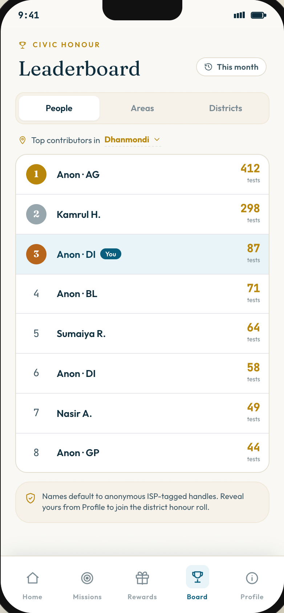
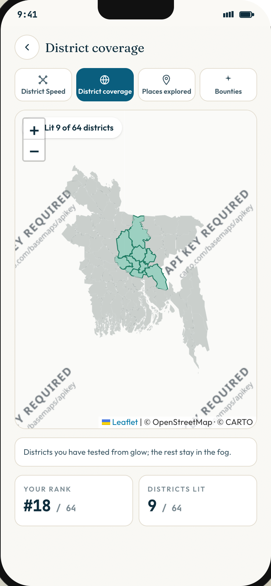

# BTRC QoS Monitor

A clickable **prototype** of a mobile app that lets people in Bangladesh measure their internet quality, compare it with what their ISP promised, and earn rewards for helping the regulator (BTRC) build a crowdsourced picture of network quality.

> **Prototype notice:** this is a front-end demo only. There is no backend. Speed tests are simulated, all data (users, leaderboards, districts, coverage map) is mock data, and nothing is sent anywhere. Progress is saved in your browser's `localStorage`.

## The problem

Advertised broadband and mobile speeds often differ from what customers actually get, and regulators have little ground-level data to check. The idea: make testing rewarding enough that many people do it regularly, then use the pooled results to show where service is good or poor.

## How you use it

The app runs in the browser inside a phone-shaped frame:

1. **Onboard**: enter a phone number, confirm an OTP, give consent, then pick your ISP and package.
2. **Run a test** from the home screen (Quick, or Full QoS).
3. **See your result**: connection quality, speed, latency, jitter, packet loss, and how your delivered speed compares to your plan.
4. **Earn XP**, complete missions, unlock badges, climb leaderboards, and redeem XP for rewards.

## Screenshots

Captured from the running app.

| Home | Test running | Result |
|---|---|---|
|  |  |  |
| Level, streak and test buttons | Simulated test in progress | Quality rating and advertised vs delivered speed |

| Missions | Leaderboard | District coverage map |
|---|---|---|
|  |  |  |
| Daily and weekly missions | People, Areas and Districts boards | Districts tested so far (mock data) |

More: [Rewards](screenshots/06-rewards.png) · [Profile](screenshots/07-profile.png)

## Features

- **Speed test** with two modes: *Quick* (speed only) and *Full QoS* (stability, speed, reliability). Results are simulated (see [Current limitations](#current-limitations)).
- **Advertised vs delivered speed**: the result screen compares the measured speed against the plan you selected.
- **Quality summary**: download, latency, jitter and packet loss, with plain-language ratings (e.g. suitability for gaming, video calls, streaming).
- **XP, levels and streaks**: each test earns XP; levels and a daily streak track progress.
- **Missions**: daily, weekly and milestone missions with progress bars.
- **Badges**: collectible badges across several tiers.
- **Leaderboards**: ranking by People, Areas and Districts.
- **Rewards**: spend XP on data/voice/SMS perks (vouchers are generated locally) and view redemption history.
- **Complaints**: an ISP complaint form (UI only; submitting does nothing yet).
- **District coverage map**: Leaflet map of Bangladesh with four layers (District Speed, District coverage, Places explored, Bounties), driven by mock JSON. Reach it from **Profile → Districts explored / Places explored**.
- **History and inbox**: past tests and notifications.
- **English / Bangla** and **light / dark** themes.
- **Demo controls** (button below the phone): switch personas and trigger level-ups, badges, mission completions and error states (network error, GPS denied, VPN detected, etc.) without playing through them.

## Tech stack

- [React 18](https://react.dev) + [Vite 6](https://vitejs.dev)
- [Tailwind CSS 3](https://tailwindcss.com)
- [Leaflet](https://leafletjs.com) for the map (Carto/OpenStreetMap basemap tiles)
- No backend; state in `localStorage`, map data from static JSON in `public/data/`

## Project structure

```
src/
  main.jsx, App.jsx     entry point; App holds app state and switches screens
  screens/              one file per screen (Onboard, Home, Testing, Result,
                        Missions, Leaderboard, Rewards, Badges, Map, Complaint, ...)
  components/           phone frame, bottom nav, modals, overlays, demo panel
  data/                 mock seed data: ISPs and plans, personas, missions, badges
  state/store.js        localStorage load/save
  lib/                  geohash helper, event bus
public/data/            mock JSON for the map (+ bd-districts.geojson boundaries)
generate-mock-data.js   script that builds the map JSON from the boundaries
```

Design and requirements documents (`srs.md`, `backend-srs.md`, `api-design.md`, `architecture.md`, `openapi.yaml`) describe a proposed future backend and are **not implemented** in this prototype.

## Getting started

**Prerequisites:** [Node.js](https://nodejs.org) 18 or newer (developed on Node 22) and npm.

```bash
git clone https://github.com/MaishaMeherin/btrc-qos-monitor.git
cd btrc-qos-monitor
npm install
npm run dev
```

Open **http://localhost:5173** in your browser.

The map's mock data is already committed in `public/data/`, so nothing else is required. To regenerate it (optional):

```bash
npm run generate-mock-data
```

**Production build:**

```bash
npm run build      # outputs to dist/
npm run preview    # serves it at http://localhost:4173
```

**Start over:** click **↺ Reset demo** under the phone, or clear this site's `localStorage`.

## How the prototype works

- `App.jsx` keeps the app state (user, history, selected ISP and plan, language, theme) and renders the current screen. It saves to `localStorage` on every change, so a refresh keeps your progress.
- **Speed tests are scripted.** A timed sequence animates the gauge, then finishes with fixed values (46.4 Mbps down, 10.9 Mbps up, 24 ms latency). Nothing is actually measured.
- **Advertised vs delivered** compares that value with the download speed of the package chosen during onboarding.
- **XP, missions, badges, leaderboards and rewards** use the seed data in `src/data/seed.js` plus client-side logic.
- **The map** fetches `/data/*.json` generated by `generate-mock-data.js` from real district boundaries with synthetic speeds and tests.

## Current limitations

- No backend: no real accounts, SMS/OTP, data submission, or server-side rankings. Onboarding asks for a phone number and a 6-digit code, but nothing is verified.
- Speed test results are simulated, not measured.
- Leaderboards, missions, districts and the coverage map use mock data.
- The complaint form's Submit button is not connected to anything.
- The map basemap uses Carto's public tile URL, which currently shows an "API key required" watermark over the tiles. The district overlays still display correctly.
- Designed for a desktop browser showing a 390×844 phone frame; not responsive for real phones.
