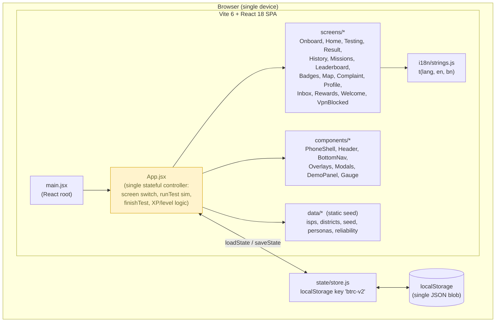
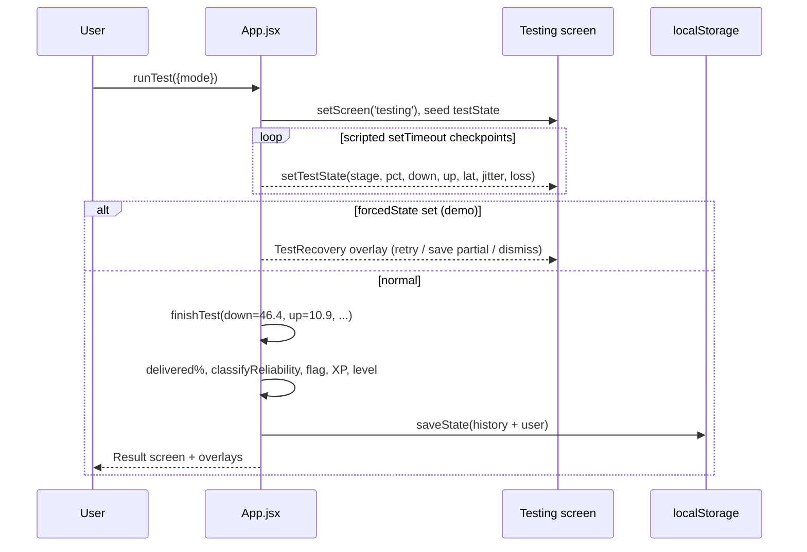
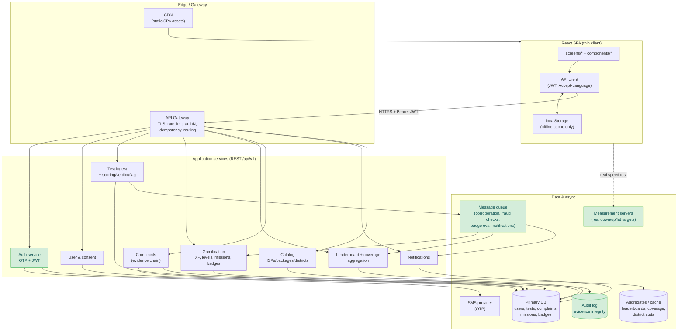
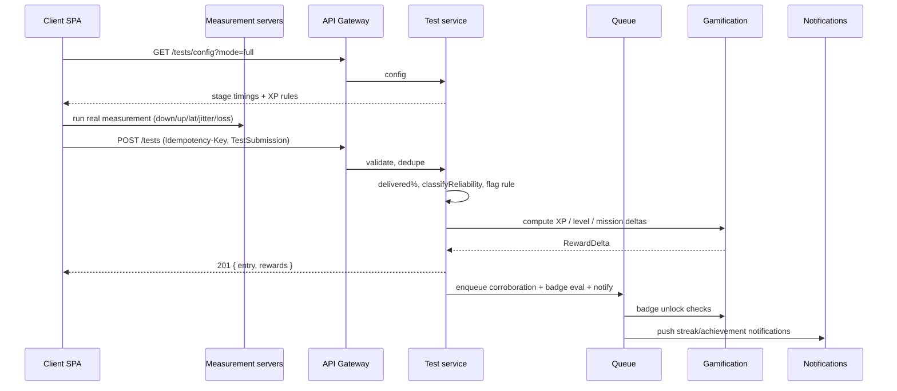
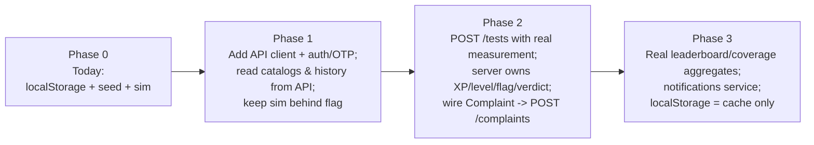

# Architecture — BTRC QoS Monitor

**Date:** 2026-05-30 · Companion to `srs.md`, `api-design.md`, `openapi.yaml`.

This document shows **two architectures**: the system **as it exists today**
(client-only prototype, confirmed from source) and the **proposed** production
architecture that the API design implies. Diagrams use Mermaid (renders on GitHub
and most Markdown viewers).

---

## 1. Current architecture (as-built — confirmed from source)

> No server, no API, no database. Everything runs in the browser; the only I/O is
> `localStorage`. The "speed test" is a scripted `setTimeout` timeline.

**Key facts (from `srs.md`):**
- `App.jsx` holds all state and the simulated test engine; screens are presentational.
- Persistence = one `localStorage` key (`btrc-v2`) written on every state change.
- No `fetch`/network, no auth, no routing (string `screen` switch).
- Complaint submit button has **no handler** (dead).

### 1.1 Current "test" flow (simulation)

---

## 2. Proposed architecture (production target)

> Adds the backend the prototype lacks. The React app becomes a thin client; truth
> (measurements, XP/levels, leaderboards, complaints) moves server-side. See
> `openapi.yaml` for the contract.

Green = net-new vs. today. Everything outside the `Client` box does not exist in the
current build.

### 2.1 Proposed test-submission flow

### 2.2 Migration path (client side)

---

## 3. Component → service mapping

| Client today | Proposed service | Endpoint(s) |
|---|---|---|
| `Onboard` consents + ISP pick | Auth + User + Catalog | `/auth/otp/*`, `/users/me/consents`, `/catalog/*` |
| `runTest`/`finishTest` (sim) | Test ingest + Gamification | `GET /tests/config`, `POST /tests` |
| `History` / `HistoryDetail` | Test | `GET /tests`, `GET /tests/{id}` |
| `Missions` | Gamification | `GET /missions`, `POST /missions/{id}/claim` |
| `Badges` | Gamification | `GET /badges`, `GET /badges/{id}` |
| `Leaderboard` | Leaderboard | `GET /leaderboard?scope=` |
| `Map` (`BD_DOTS`) | Coverage | `GET /coverage/districts` |
| `Complaint` (dead button) | Complaints | `POST /complaints` |
| `Inbox` (`openInbox`) | Notifications | `GET /notifications`, `POST /notifications/read` |
| `Profile` | User | `PATCH /users/me`, `GET /users/me/stats` |
| `localStorage` (`store.js`) | — | becomes offline cache only |
| `DemoPanel` / personas | — | dev-only; dropped or gated in prod |

---

*Section 1 is confirmed from `qos-app/src`. Section 2 is a proposal; no server-side
component exists in the current build.*
